# Lab 05 Report: Phishing Analysis Fundamentals

**Platform:** TryHackMe: https://tryhackme.com/room/phishingemails1tryoe  

## Introduction

In this lab I learned the basics of analysing suspicious emails. I looked at how an email address is built, how emails travel from the sender to the receiver, what information is hidden in the email header, how attachments are stored inside an email, and the common signs of a phishing email. I used a Linux lab machine with three sample emails to practise, and I finished the room with all 7 tasks done.

## Tools Used

- TryHackMe lab machine (Linux) with the Email Samples folder (email1.eml, email2.txt, email3.eml)
- Mozilla Thunderbird to open the emails and view the message source
- Mousepad text editor to read the raw email text
- Linux terminal with base64 and pdftotext to rebuild and read the PDF attachment

## Lab Tasks

### Task 1: Introduction

#### Important points

- Spam and phishing are the most common social engineering threats that companies face.
- Spam is usually low risk, but phishing can trick users into giving away sensitive information or installing malware.
- Just one user clicking a bad link or opening a bad attachment can give an attacker a foothold in the network.
- As a defender, the job is to check the parts of an email and decide if it is malicious or safe.
- The goals of the room were to learn about email delivery, header analysis, email bodies, types of phishing, and how to analyse emails for threats.
- I started the lab machine. The sample emails were in the Email Samples folder on the desktop.

#### Questions

**Q1. I am ready to learn about phishing analysis!**

Answer: **No answer needed**

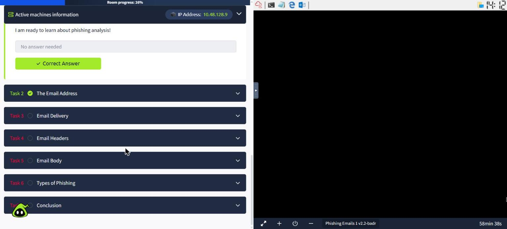
*Figure 1: Task 1 completed and the lab machine started*

### Task 2: The Email Address

#### Important points

- Email was invented in the 1970s by Ray Tomlinson, who also chose the @ symbol.
- An email address has three parts:
    - the user mailbox or username (for example: hatsalesman)
    - the @ symbol
    - the domain (for example: tryhatme.com)
- It works like a postal address: the domain is the 'building' and the username is the 'person' inside it.
- Checking the domain is one of the first steps in spotting a fake email, because attackers often use domains that look almost the same as real ones.

#### Questions

**Q1. Identify the domain used in the following email address: hatsalesman@tryhatme.com**

*How I found it:* I looked at the part of the address after the @ symbol.

Answer: **tryhatme.com**

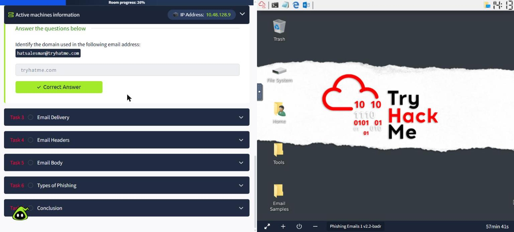
*Figure 2: Task 2 answer marked correct*

### Task 3: Email Delivery

#### Important points

- Several protocols work together to deliver an email:
    - SMTP (Simple Mail Transfer Protocol): sends emails
    - POP3 (Post Office Protocol): downloads emails to one device
    - IMAP (Internet Message Access Protocol): keeps emails synced across many devices
- POP3: emails are downloaded and stored on one device, sent messages stay on that device, and emails are usually removed from the server after download.
- IMAP: emails stay on the server and can be read from many devices, and sent messages are also saved on the server.
- How an email is delivered:
    - 1. The sender writes the email and sends it to their mail server using SMTP.
    - 2. The mail server uses DNS to find the recipient domain's mail server.
    - 3. DNS returns the address of the recipient's mail server.
    - 4. The email is sent over the Internet to the recipient's server.
    - 5. The recipient's email client connects to their mail server.
    - 6. The email is downloaded (POP3) or synced (IMAP) to the recipient's device.

#### Questions

**Q1. Which protocol is responsible for sending an email from a client to a mail server?**

Answer: **SMTP**

**Q2. Which service is used to look up the recipient domain's mail server?**

Answer: **DNS**

**Q3. Bob wants to access his email from multiple devices, including his phone and laptop. Which protocol should he use?**

*How I found it:* POP3 only keeps emails on one device, but IMAP keeps them synced across all devices, so IMAP is the right choice.

Answer: **IMAP**

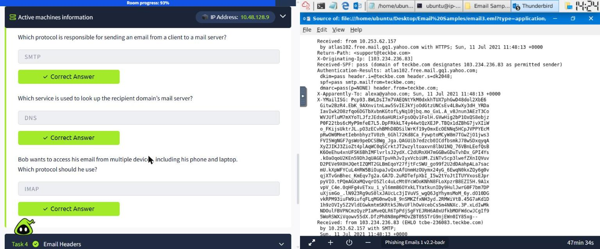
*Figure 3: Task 3 answers marked correct*

### Task 4: Email Headers

#### Important points

- An email has two main parts: the header and the body.
- The header holds information about the message, such as who sent it and which servers it passed through.
- The body holds the actual message, which can be plain text or HTML.
- The main header fields are:
    - From: the sender's email address
    - To: the receiver's email address
    - Reply-To: where replies will go (this can be different from the sender, which is a warning sign)
    - Subject: the subject line
    - Date: when the email was sent
- In Thunderbird, the full raw email can be seen with View → Message Source (Ctrl+U).
- The raw source shows extra headers that the normal view hides, like:
    - Received: the servers the email passed through
    - X-Originating-IP: the IP address the email was first sent from
    - Return-Path: where bounced emails go
    - Authentication-Results: the SPF, DKIM and DMARC checks
- The originating IP address is very useful, because it can be looked up to see where the email really came from.

#### Questions

**Q1. What is the full subject line of email1.eml?**

*How I found it:* I opened the Email Samples folder on the lab machine's desktop and opened email1.eml. It opened in Thunderbird, and I read the Subject line at the top of the email.

Answer: **Help protect your budget by protecting your home**

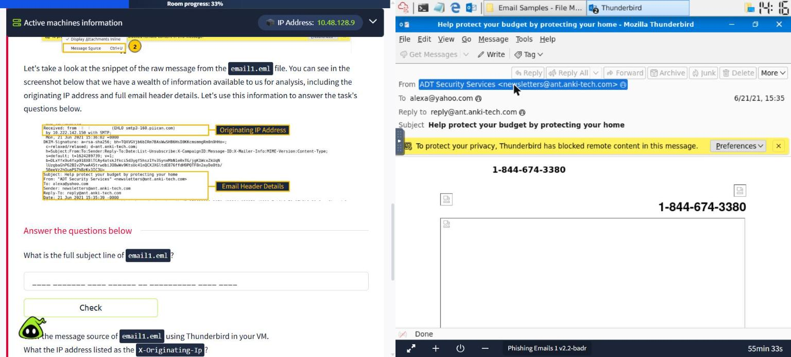
*Figure 4: email1.eml opened in Thunderbird, showing the From, To, Reply-to and Subject fields*

**Q2. View the message source of email1.eml using Thunderbird. What is the IP address listed as the X-Originating-Ip?**

*How I found it:* In Thunderbird I went to View → Message Source. In the raw source I found the X-Originating-Ip header near the top.

Answer: **43.255.56.161**

![The message source of email1.eml with X-Originating-Ip: [43.255.56.161]](PhishingAnalysis_screenshots/05_email1_source.jpg)
*Figure 5: The message source of email1.eml with X-Originating-Ip: [43.255.56.161]*

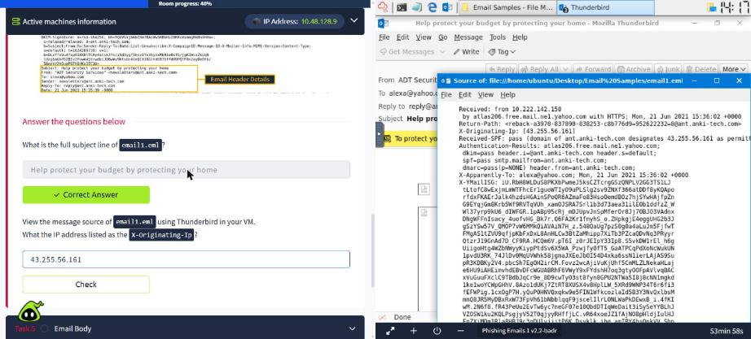
*Figure 6: Task 4 answers entered*

### Task 5: Email Body

#### Important points

- The email body is the part that holds the message the user reads.
- It can be plain text or HTML. HTML emails can contain images, buttons and hidden links.
- Attackers often hide the real link behind a button or text, so the link should be checked before clicking.
- Attachments are stored inside the email as text, using base64 encoding.
- The important headers for an attachment are:
    - Content-Type: the type of the file (for example application/pdf)
    - Content-Disposition: shows it is an attachment and gives the filename
    - Content-Transfer-Encoding: shows how it is encoded (base64)
- The base64 text can be decoded to rebuild the original file using CyberChef, an online converter or the base64 command on Linux.
- Attachments from suspicious emails should only be opened in a safe environment like a lab machine or sandbox.

#### Questions

**Q1. Open up the email2.txt file to view the source of an attachment. What is the Content-Type of the attachment?**

*How I found it:* I opened email2.txt from the Email Samples folder in the Mousepad text editor. Near the attachment section I found the line 'Content-Type: application/pdf'.

Answer: **application/pdf**

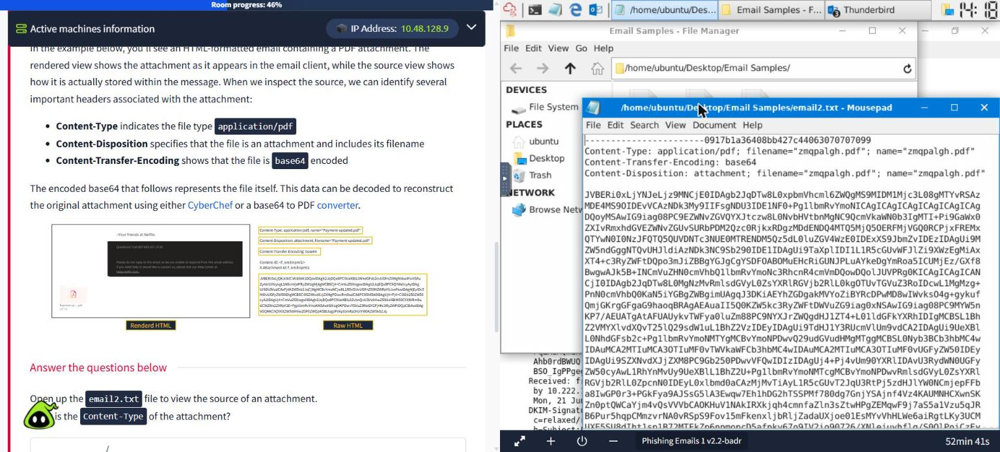
*Figure 7: email2.txt showing the attachment headers and the start of the base64 data*

**Q2. What is the name of the attachment from the previous question?**

*How I found it:* On the same screen, the Content-Disposition line says filename="zmqpalgh.pdf".

Answer: **zmqpalgh.pdf**

**Q3. Decode the base64 string using either a PDF converter or CyberChef. What is the hidden flag value?**

*How I found it:* I opened the terminal on the lab machine, went to the Email Samples folder, took the base64 text after the Content-Disposition line and decoded it into a PDF with base64 -d. The file command confirmed it was a real PDF (version 1.6), and pdftotext showed the text inside, which was the flag.

Answer: **THM{BENIGN_PDF_ATTACHMENT}**

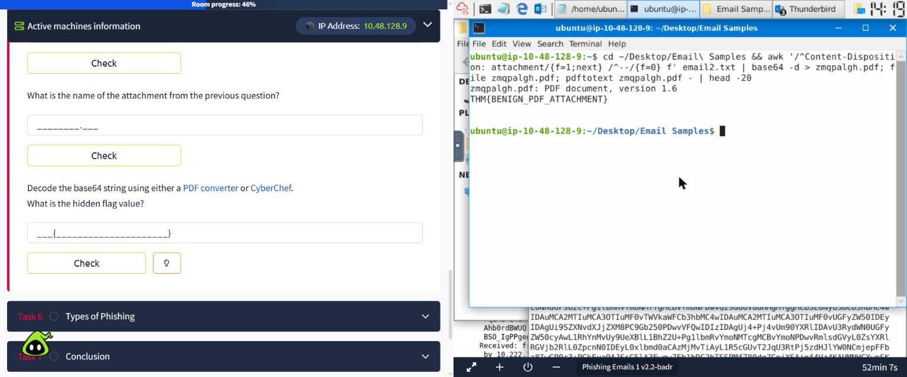
*Figure 8: Terminal showing the PDF rebuilt from base64 and the flag inside it*

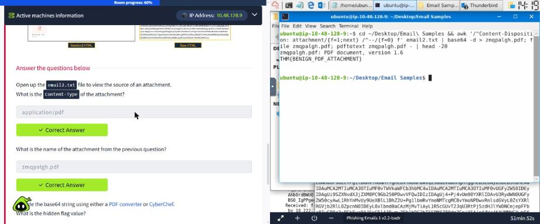
*Figure 9: Task 5 answers marked correct*

### Task 6: Types of Phishing

#### Important points

- Email is one of the most common ways attacks start, and it usually depends on social engineering.
- Types of malicious emails:
    - Spam: unwanted bulk email sent to many people (the malicious kind is called malspam)
    - Phishing: pretends to be a trusted company to steal information
    - Spear phishing: phishing aimed at one person or company, using personal details
    - Whaling: spear phishing aimed at top managers like a CEO or CFO
    - Smishing: phishing done through SMS text messages
    - Vishing: phishing done through phone calls
- Common signs of a phishing email:
    - Spoofed From address (for example noreply@microsof.com)
    - Urgent message ("Your account will be locked in 24 hours")
    - Brand impersonation (copied logos and colours)
    - Spelling and grammar mistakes
    - Generic greeting ("Dear Customer")
    - Hidden or shortened links (bit.ly/...)
    - Malicious attachments (invoice.pdf.exe)
- Links and IP addresses should be defanged before sharing them, so nobody clicks them by mistake. For example, http://www.site.com becomes hxxp[://]www[.]site[.]com.

#### Questions

**Q1. Which reputable organization is being spoofed in this phishing attempt?**

*How I found it:* I opened email3.eml in Thunderbird. The sender name was 'Thank you! Home Depot' and the subject was a fake order confirmation (Order ID OD2321657089291).

Answer: **Home Depot**

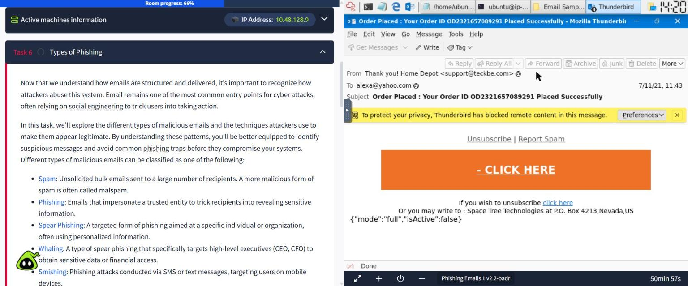
*Figure 10: email3.eml: pretends to be Home Depot but is sent from support@teckbe.com*

**Q2. What is the sender's email address?**

*How I found it:* On the same screen, the real address in the From field is support@teckbe.com. This domain has nothing to do with Home Depot, which shows it is fake.

Answer: **support@teckbe.com**

**Q3. Inspect the email message source. What is the defanged X-Originating-IP?**

*How I found it:* I opened View → Message Source and found X-Originating-Ip: [103.234.236.83]. To defang it, I replaced each dot with [.].

Answer: **103[.]234[.]236[.]83**

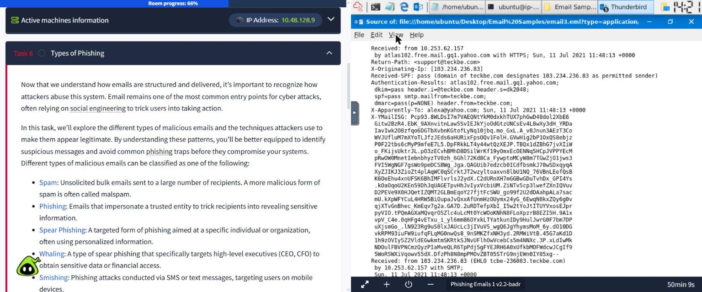
*Figure 11: The message source of email3.eml showing X-Originating-Ip and Authentication-Results*

**Q4. Continue analysing the email message source. Which mail server generated the Authentication-Results header?**

*How I found it:* In the same source, the Authentication-Results header starts with the server name atlas102.free.mail.gq1.yahoo.com.

Answer: **atlas102.free.mail.gq1.yahoo.com**

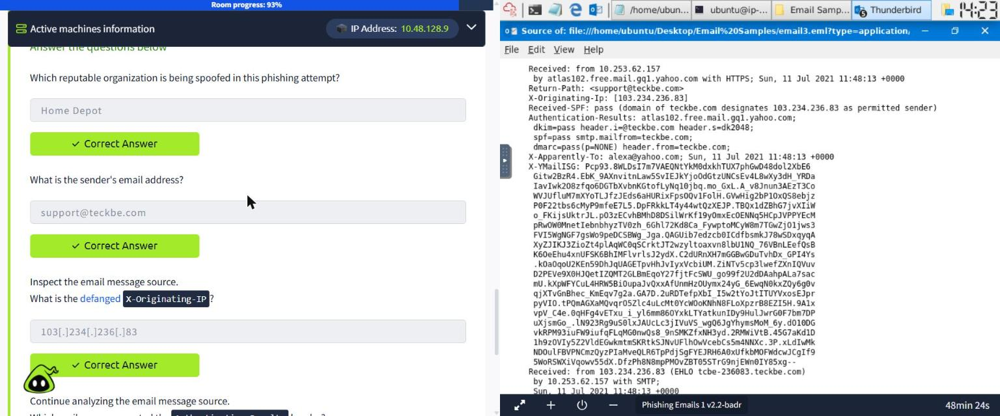
*Figure 12: Task 6 answers marked correct next to the email source*

### Task 7: Conclusion

#### Important points

- In this room I learned how an email is built, how it is delivered, and how to check its header and body for warning signs.
- Business Email Compromise (BEC) is an attack where the attacker takes over a real company email account and uses it to trick other employees into fraud, like paying fake invoices.
- BEC is dangerous because the email comes from a real, trusted account, so normal checks may not catch it.
- This room is the first in the Phishing Analysis module. The next rooms are Phishing Emails in Action, Phishing Analysis Tools, Phishing Prevention, The Greenholt Phish and Snapped Phish-ing Line.

#### Questions

**Q1. What attack, signified by the acronym BEC, uses a compromised email to trick employees into fraud?**

Answer: **Business Email Compromise**

*Figure 13: Room completed: 7 taskss*

## Findings

The first email (email1.eml) claimed to be from "ADT Security Services", with the subject "Help protect your budget by protecting your home". Its message source showed that it came from the IP address 43.255.56.161 and that replies would go to a different address (reply@ant.anki-tech.com). This is a typical marketing or spam email.

The second file (email2.txt) had a PDF attachment called zmqpalgh.pdf stored as base64 text. I rebuilt the PDF in the terminal and found that it was harmless and only contained the flag THM{BENIGN_PDF_ATTACHMENT}. This showed me how attachments can be pulled out of an email and checked safely without opening the email itself.

The third email (email3.eml) was a clear phishing email. It pretended to be a Home Depot order confirmation, but it was really sent from support@teckbe.com, a domain that has nothing to do with Home Depot. It used a big orange "CLICK HERE" button to get the reader to click a link. The message source showed that it came from the IP address 103.234.236.83, and the Authentication-Results header was added by Yahoo's mail server atlas102.free.mail.gq1.yahoo.com. The SPF check passed only because the attacker controls the teckbe.com domain, which shows that a passing check does not always mean an email is safe.

## Conclusion

This lab taught me that an email can look normal on the screen but still hide a lot of useful evidence. By opening the message source I could see the real sender, the IP address it came from and the servers it passed through. I also learned how attachments are stored as base64 and how to rebuild them safely, and how to spot the common signs of phishing like a fake sender, a copied brand and an urgent button. These are basic skills that every SOC analyst needs to check suspicious emails.
