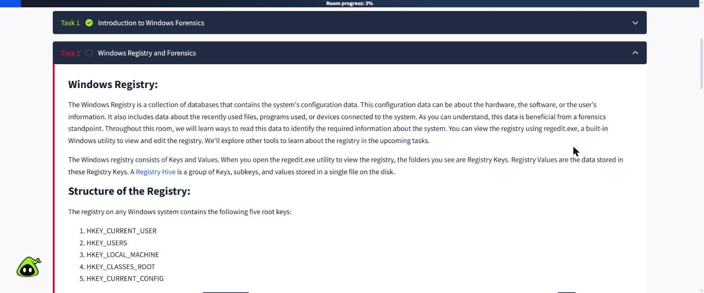
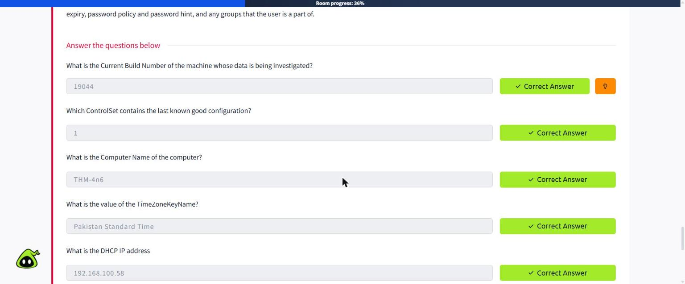
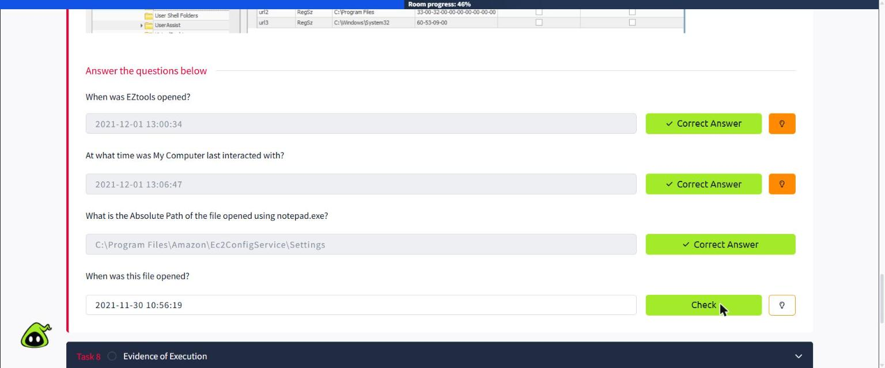
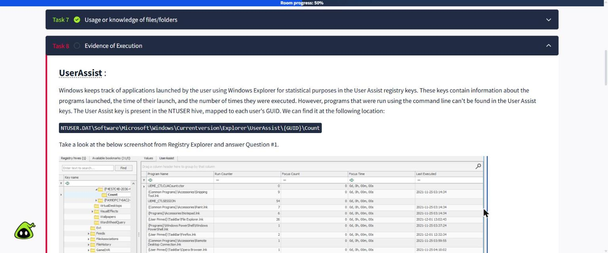
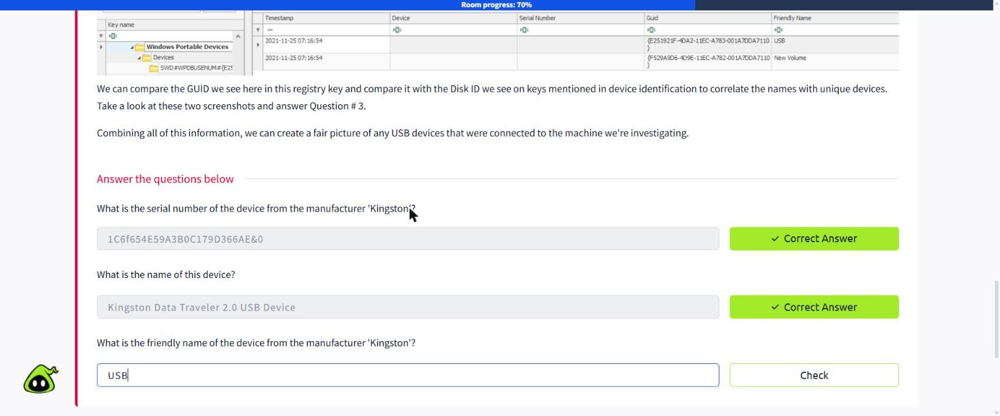
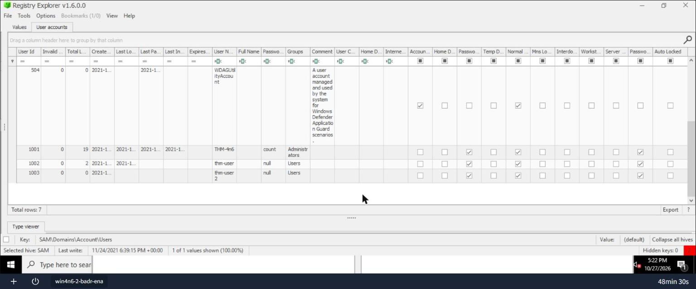
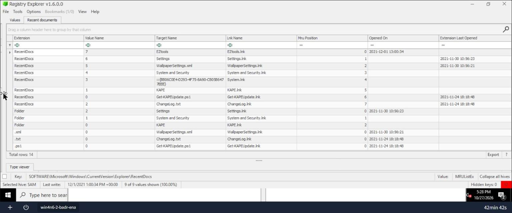
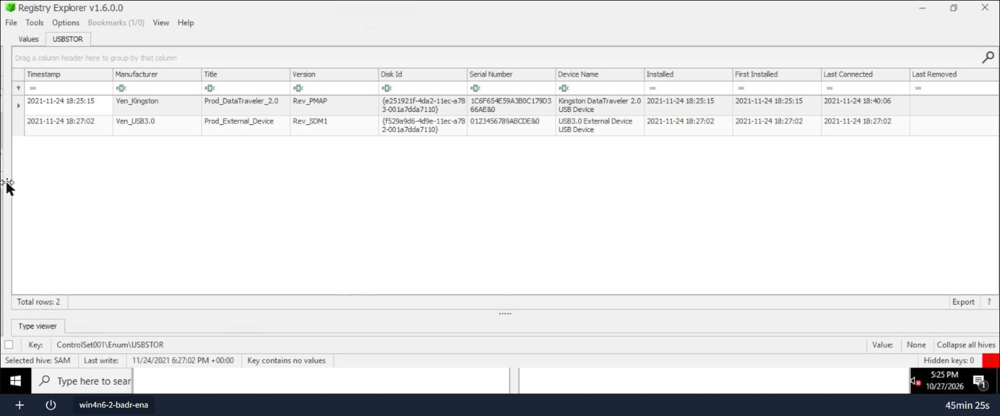
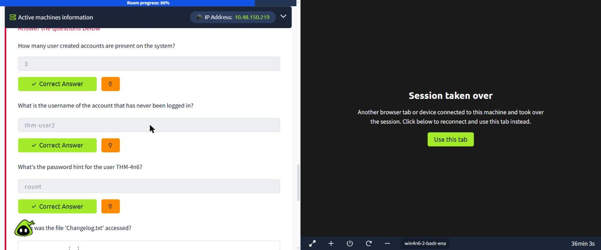

# Lab 05 Report: Windows Forensics 1

**Platform:** TryHackMe: https://tryhackme.com/room/windowsforensics1  

## Introduction

In this lab I learned how to use the Windows Registry to investigate what happened on a computer. The registry stores Windows settings, but it also keeps a record of what users do: which accounts exist, which files were opened, which programs were run and which USB drives were plugged in. I worked through all 11 tasks.

## Tools Used

- TryHackMe Windows lab machine
- Registry Explorer by Eric Zimmerman
- Web browser to read the tasks and submit the answers

## Lab Tasks

### Task 1: Introduction to Windows Forensics

#### Important points

- Computer forensics is the process of finding, collecting and analysing evidence of what was done on a computer.
- It is a part of digital forensics, which covers all kinds of digital devices like phones, servers and computers.
- It is used in many situations: court cases (criminal and civil), company investigations and cyber security incident response.
- The evidence must be handled carefully so it is not changed, otherwise it may not be accepted.
- Microsoft Windows has about 80% of the desktop market, so most investigations involve a Windows machine.
- Windows keeps a lot of activity records in the background, which makes it a good source of evidence.
- In this room the focus is on one of the most important Windows sources: the registry.

#### Questions

**Q1. What is the most used Desktop Operating System right now?**

Answer: **Microsoft Windows**

*Figure 1: Task 1 completed*

### Task 2: Windows Registry and Forensics

#### Important points

- The Windows Registry is a collection of databases that store the computer's configuration data.
- It holds settings for hardware, software and users, and also records recently used files, programs and connected devices.
- The registry is made of keys and values. Keys are like folders and values are the data saved inside them.
- A registry hive is a group of keys, subkeys and values saved in one file on the disk.
- There are five root keys:
    - HKEY_CURRENT_USER (HKCU): settings for the user who is logged in, like folders, colours and Control Panel settings.
    - HKEY_USERS (HKU): all the user profiles loaded on the computer. HKCU is a subkey of this.
    - HKEY_LOCAL_MACHINE (HKLM): settings that apply to the whole computer, for every user.
    - HKEY_CLASSES_ROOT (HKCR): file associations, so Windows knows which program opens which file type.
    - HKEY_CURRENT_CONFIG (HKCC): the hardware profile the computer used when it started.
- On a live system, the registry can be viewed and edited with the built-in tool regedit.exe.

#### Questions

**Q1. What is the short form for HKEY_LOCAL_MACHINE?**

Answer: **HKLM**

### Task 3: Accessing Registry Hives Offline

#### Important points

- When we only have a disk image (not a running computer), we must know where the hive files are saved on the disk.
- Most system hives are in C:\Windows\System32\Config:
    - DEFAULT (mounted on HKEY_USERS\DEFAULT)
    - SAM (mounted on HKEY_LOCAL_MACHINE\SAM): user accounts
    - SECURITY (mounted on HKEY_LOCAL_MACHINE\Security): security settings 
    - SOFTWARE (mounted on HKEY_LOCAL_MACHINE\Software): installed programs and Windows settings
    - SYSTEM (mounted on HKEY_LOCAL_MACHINE\System): hardware, services, network and USB devices
- Each user has two hives in their profile:
    - NTUSER.DAT in C:\Users\<username>\ (mounted on HKCU when the user logs in)
    - USRCLASS.DAT in C:\Users\<username>\AppData\Local\Microsoft\Windows (mounted on HKCU\Software\Classes)
- The AmCache hive (C:\Windows\AppCompat\Programs\Amcache.hve) saves information about programs that were recently run.
- Transaction logs (.LOG1, .LOG2) record changes that have not been written to the hive yet, so they can hold the most recent activity.
- Registry backups are saved in C:\Windows\System32\Config\RegBack, usually every ten days. These are useful if keys were deleted or changed.

#### Questions

**Q1. What is the path for the five main registry hives, DEFAULT, SAM, SECURITY, SOFTWARE, and SYSTEM?**

Answer: **C:\Windows\System32\Config**

**Q2. What is the path for the AmCache hive?**

Answer: **C:\Windows\AppCompat\Programs\Amcache.hve**

### Task 4: Data Acquisition

#### Important points

- The forensically correct way is to make a copy (image) of the data and do all the analysis on the copy.
- This keeps the original evidence safe and unchanged.
- The hive files in %WINDIR%\System32\Config are locked by Windows while it is running, so they can't simply be copied.
- Special tools are used to collect them:
    - KAPE: a fast tool (command line or GUI) that collects and processes forensic artifacts.
    - Autopsy: can extract files from a live system or a disk image.
    - FTK Imager: can mount a disk image and export files, and has an 'Obtain Protected Files' option for registry files.
- FTK Imager's 'Obtain Protected Files' does not collect Amcache.hve, which is also important evidence.
- In this room I did not collect data myself. The data was already collected and placed on the lab machine.

#### Questions

**Q1. Try collecting data on your own system or the attached VM**

Answer: **No answer needed**

### Task 5: Exploring Windows Registry

#### Important points

- After collecting the hives, we need a tool that can read them.
- Registry Viewer (AccessData): looks like regedit, but can only open one hive at a time and does not use transaction logs.
- Registry Explorer (Eric Zimmerman):
    - can open many hives at the same time
    - can merge transaction logs into the hive to make a clean, up-to-date copy
    - has bookmarks that take you straight to the important forensic keys
    - shows the data in easy-to-read tables with plugins
- RegRipper: takes a hive as input and outputs a text report of important keys and values. It also has a GUI.
- RegRipper does not use transaction logs, so the logs should be merged with Registry Explorer first for accurate results.
- In this room I used Registry Explorer and some other Eric Zimmerman tools.

#### Questions

**Q1. Study the material to understand the difference between the tools**

Answer: **No answer needed**

### Task 6: System Information and System Accounts

#### Important points

- The first step of any investigation is to collect basic information about the system and its users.
- This helps to confirm that we are looking at the correct machine.
- OS version: SOFTWARE\Microsoft\Windows NT\CurrentVersion (shows the product name, build number and install date).
- Control Sets: the SYSTEM hive usually has ControlSet001 (the one the computer booted with) and ControlSet002 (the last known good configuration).
- Windows makes a live CurrentControlSet when it is running. SYSTEM\Select\Current shows which ControlSet it uses, and SYSTEM\Select\LastKnownGood shows the last known good one.
- Computer name: SYSTEM\CurrentControlSet\Control\ComputerName\ComputerName.
- Time zone: SYSTEM\CurrentControlSet\Control\TimeZoneInformation. This is important because some timestamps are in UTC and others are in local time.
- Network interfaces: SYSTEM\CurrentControlSet\Services\Tcpip\Parameters\Interfaces. Each interface has a GUID subkey with its IP address, DHCP IP, subnet mask and DNS servers.
- Past networks: SOFTWARE\Microsoft\Windows NT\CurrentVersion\NetworkList\Signatures\Unmanaged and \Managed. The last write time shows when each network was last connected.
- Autostart programs (Autoruns): the Run and RunOnce keys in NTUSER.DAT and SOFTWARE show programs that start when a user logs in.
- Services: SYSTEM\CurrentControlSet\Services. If the 'Start' value is 0x02, the service starts at boot.
- User accounts: SAM\Domains\Account\Users. It shows each user's RID, login count, last login, last failed login, last password change, password hint and groups.

#### Questions

**Q1. What is the Current Build Number of the machine whose data is being investigated?**

*How I found it:* I looked at the CurrentVersion key in the lesson's Registry Explorer screenshot and read the CurrentBuildNumber value.

Answer: **19044**

**Q2. Which ControlSet contains the last known good configuration?**

*How I found it:* I checked the LastKnownGood value in SYSTEM\Select.

Answer: **1**

**Q3. What is the Computer Name of the computer?**

*How I found it:* I read the ComputerName value in the ComputerName key.

Answer: **THM-4n6**

**Q4. What is the value of the TimeZoneKeyName?**

*How I found it:* I found the TimeZoneKeyName value in the TimeZoneInformation key.

Answer: **Pakistan Standard Time**

**Q5. What is the DHCP IP address?**

*How I found it:* I opened the network interface in Tcpip\Parameters\Interfaces and read the DhcpIPAddress value.

Answer: **192.168.100.58**

**Q6. What is the RID of the Guest User account?**

*How I found it:* In the SAM Users table, the Guest account has User ID 501.

Answer: **501**

*Figure 2: My Task 6 answers marked correct*

### Task 7: Usage or Knowledge of Files/Folders

#### Important points

- This task covers how to find out which files and folders a user opened.
- Recent files: NTUSER.DAT\Software\Microsoft\Windows\CurrentVersion\Explorer\RecentDocs. It lists recently opened files, with subkeys for each file type (like .txt or .pdf).
- Registry Explorer also shows the 'Last Opened' time of these files.
- Office recent files: NTUSER.DAT\Software\Microsoft\Office\VERSION (for example 15.0 = Office 2013). In Office 365 they are under ...\UserMRU\LiveID_####\FileMRU, which also saves the full path.
- ShellBags: Windows saves the view settings of each folder a user opens, in USRCLASS.DAT (Local Settings\Software\Microsoft\Windows\Shell\Bags and BagMRU) and NTUSER.DAT (Software\Microsoft\Windows\Shell\BagMRU and Bags).
- ShellBags Explorer (Eric Zimmerman) shows the ShellBags in a simple way, with first and last interacted times.
- Open/Save dialog history: ...\Explorer\ComDlg32\OpenSavePIDlMRU and LastVisitedPidlMRU. These show files and folders used in Open and Save windows.
- Typed paths: ...\Explorer\TypedPaths shows paths the user typed into the Explorer address bar.
- Searches: ...\Explorer\WordWheelQuery shows what the user searched for in Explorer.

#### Questions

**Q1. When was EZtools opened?**

*How I found it:* I looked at the RecentDocs table in the lesson and read the 'Opened On' time for EZtools.

Answer: **2021-12-01 13:00:34**

**Q2. At what time was My Computer last interacted with?**

*How I found it:* I looked at the ShellBags Explorer screenshot and read the 'Last Interacted' time for My Computer.

Answer: **2021-12-01 13:06:47**

**Q3. What is the Absolute Path of the file opened using notepad.exe?**

*How I found it:* I looked at the LastVisitedPidlMRU table and read the Absolute Path next to notepad.exe.

Answer: **C:\Program Files\Amazon\Ec2ConfigService\Settings**

**Q4. When was this file opened?**

*How I found it:* From the same row, I read the 'Opened On' time.

Answer: **2021-11-30 10:56:19**

*Figure 3: My Task 7 answers marked correct*

### Task 8: Evidence of Execution

#### Important points

- This task covers how to prove that a program was run on the computer.
- UserAssist: NTUSER.DAT\Software\Microsoft\Windows\CurrentVersion\Explorer\UserAssist\{GUID}\Count.
    - Records programs started from Windows Explorer, how many times they ran and the last run time.
    - Programs started from the command line are not recorded here.
    - The values are encoded (ROT13), but Registry Explorer decodes them automatically.
- ShimCache / AppCompatCache: SYSTEM\CurrentControlSet\Control\Session Manager\AppCompatCache.
    - Used by Windows to check program compatibility.
    - Stores the file name, file size and last modified time of programs.
    - AppCompatCacheParser.exe can turn it into a CSV file.
- AmCache: C:\Windows\AppCompat\Programs\Amcache.hve.
    - Stores the full path, install time, run time, deletion time and the SHA1 hash of programs.
    - The data is in Amcache.hve\Root\File\{Volume GUID}\.
- BAM / DAM (Background Activity Monitor / Desktop Activity Moderator): SYSTEM\CurrentControlSet\Services\bam\UserSettings\{SID} and \dam\UserSettings\{SID}.
    - Part of Windows power management.
    - Stores the full path and last run time of programs for each user.

#### Questions

**Q1. How many times was the File Explorer launched?**

*How I found it:* I zoomed into the UserAssist screenshot in the lesson and read the Run Counter for File Explorer.lnk.

Answer: **26**

**Q2. What is another name for ShimCache?**

Answer: **AppCompatCache**

**Q3. Which of the artifacts also saves SHA1 hashes of the executed programs?**

Answer: **AmCache**

**Q4. Which of the artifacts saves the full path of the executed programs?**

Answer: **BAM/DAM**

*Figure 4: UserAssist table in the lesson – File Explorer has a run count of 26*

### Task 9: External Devices / USB Device Forensics

#### Important points

- Investigators often need to know if a USB or other removable drive was connected, for example in data theft cases.
- Device identification keys:
    - SYSTEM\CurrentControlSet\Enum\USBSTOR
    - SYSTEM\CurrentControlSet\Enum\USB
- These keys store the vendor ID, product ID, version and serial number of each USB device, and the time it was plugged in.
- First and last times: SYSTEM\CurrentControlSet\Enum\USBSTOR\Ven_Prod_Version\USBSerial#\Properties\{83da6326-97a6-4088-9453-a19231573b29}\####
    - 0064 = first connection time
    - 0066 = last connection time
    - 0067 = last removal time
- Registry Explorer's USBSTOR plugin shows all of this in one table.
- USB device name (volume name): SOFTWARE\Microsoft\Windows Portable Devices\Devices. This gives the friendly name of the drive.
- The GUID in Portable Devices can be matched with the Disk ID in USBSTOR to link the friendly name to the correct device.
- Putting all of this together gives a clear picture of which USB devices were used and when.

#### Questions

**Q1. What is the serial number of the device from the manufacturer 'Kingston'?**

*How I found it:* I zoomed into the USBSTOR screenshot and read the Serial Number in the Ven_Kingston row.

Answer: **1C6f654E59A3B0C179D366AE&0**

**Q2. What is the name of this device?**

*How I found it:* From the same row, I read the Device Name column.

Answer: **Kingston Data Traveler 2.0 USB Device**

**Q3. What is the friendly name of the device from the manufacturer 'Kingston'?**

*How I found it:* I matched the Kingston Disk ID ({e251921f-...}) with the GUID in the Portable Devices screenshot, and its friendly name was 'USB'.

Answer: **USB**

*Figure 5: My Task 9 answers marked correct*

### Task 10: Hands-on Challenge

#### Important points

- This was the practical part, where I used what I learned on real evidence.
- Scenario: one of the desktops at Organization X may have been accessed by someone unauthorised. There were several user accounts on it, and a network drive and a USB device may have been connected.
- The lab machine logs in as THM-4n6. Two folders were on the desktop:
    - triage: the evidence collected with KAPE, with the same folder layout as the original C: drive.
    - EZtools: Eric Zimmerman's tools, including Registry Explorer, EZViewer and AppCompatCacheParser.
- Autopsy was also on the desktop, but the room suggested using the EZ tools.
- Which hive answers which question:
    - SAM → user accounts, logins and password hints
    - NTUSER.DAT → recent files and programs run (RecentDocs, UserAssist)
    - SYSTEM → USB devices (USBSTOR)
- When loading the hives, Registry Explorer said some were 'dirty'. This means recent changes were still in the .LOG1 and .LOG2 files.
- To fix it, I pointed Registry Explorer to the .LOG1 and .LOG2 files. It merged them and saved a clean hive, which I then used for the analysis.

#### Questions

**Q1. How many user created accounts are present on the system?**

*How I found it:* I started the lab machine and ran Registry Explorer as administrator from Desktop\EZtools\RegistryExplorer. I used File > Load hive to open triage\C\Windows\System32\config\SAM and clicked the Users bookmark. There were 7 accounts. Administrator, Guest, DefaultAccount and WDAGUtilityAccount are built into Windows, so the user-created accounts are THM-4n6, thm-user and thm-user2.

Answer: **3**

*Figure 6: SAM hive: 3 user-created accounts, thm-user2 never logged in, password hint 'count'*

**Q2. What is the username of the account that has never been logged in?**

*How I found it:* In the same Users table (Figure above), thm-user2 had a Total Login Count of 0 and no Last Login Time.

Answer: **thm-user2**

**Q3. What's the password hint for the user THM-4n6?**

*How I found it:* In the same table, I read the Password Hint column for THM-4n6.

Answer: **count**

**Q4. When was the file 'Changelog.txt' accessed?**

*How I found it:* I loaded triage\C\Users\THM-4n6\NTUSER.DAT. It was dirty, so I clicked Yes to replay the logs, selected ntuser.dat.LOG1 and ntuser.dat.LOG2, saved the clean hive and loaded it. Then I opened the RecentDocs key and found ChangeLog.txt in the .txt row.

Answer: **2021-11-24 18:18:48**

*Figure 7: RecentDocs in NTUSER.DAT: ChangeLog.txt opened 2021-11-24 18:18:48*

**Q5. What is the complete path from where the python 3.8.2 installer was run?**

*How I found it:* This is in the UserAssist data. The path starts with Z:, which shows the installer was run from a network drive.

Answer: **Z:\setups\python-3.8.2.exe**

**Q6. When was the USB device with the friendly name 'USB' last connected?**

*How I found it:* I loaded the SYSTEM hive, replayed SYSTEM.LOG1 and SYSTEM.LOG2, and saved it as SYSTEM_clean. Then I searched for the USBSTOR bookmark and read the Last Connected time for the Kingston device.

Answer: **2021-11-24 18:40:06**

*Figure 8: USBSTOR in the SYSTEM hive: Kingston USB last connected 2021-11-24 18:40:06*

*Figure 9: My Task 10 answers marked correct*

### Task 11: Conclusion

#### Important points

- The room ended with a summary of what was covered:
    - finding basic information about the computer and its users
    - finding which files and folders were used
    - finding which programs were run
    - finding which external devices were connected
- A Registry Forensics cheat sheet was given, which lists all the important registry locations in one place.
- These skills are the base of Windows forensics. The next room (Windows Forensics 2) covers the file system and other artifacts.

#### Questions

**Q1. Read the conclusion and download the cheat sheet**

Answer: **No answer needed**

*Figure 10: Room completed: 11 tasks, 216 points*

## Findings

From my investigation, I found that the computer was named THM-4n6. It was running Windows 10 (build 19044), and its time zone was set to Pakistan Standard Time. Its IP address was 192.168.100.58, which helped confirm I was looking at the right machine.

There were seven accounts on the computer, but four of them are built into Windows. That means three accounts were created by people: THM-4n6, thm-user and thm-user2. The account thm-user2 was never logged into, which is suspicious, because it means someone created it but nobody used it. The main user, THM-4n6, had the password hint "count".

Looking at the user's recent activity, I found that the file ChangeLog.txt was opened on 24 November 2021 at 18:18:48. File Explorer had been opened 26 times, and tools like KAPE and EZtools had also been used on the computer.

Finally, a Kingston DataTraveler 2.0 USB stick with the serial number 1C6F654E59A3B0C179D366AE&0 and the name "USB" was plugged into the computer. It was first connected on 24 November 2021 at 18:25:15 and last connected at 18:40:06 on the same day. This confirms that a USB device was used on the computer, which could have been used to copy data.

## Conclusion

This lab showed me how much Windows keeps track of. By opening a few registry hives in Registry Explorer, I could see who had accounts, what files were opened, what programs were run and which USB drives were used, with exact times. I also learned to always work on a copy of the evidence and to merge the transaction logs first so no recent activity is missed.
